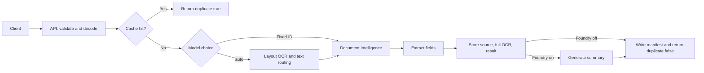

# Document Intelligence and Foundry

A Python document-processing backend that accepts Base64 JSON, stores a PDF or
image in Azure Blob Storage, and extracts OCR/layout information with Azure AI
Document Intelligence. Optional Microsoft Foundry summaries are disabled by
default.

> **Current scope:** the API supports a configured model, an explicitly selected
> model, or `modelId=auto` for OCR-text-based routing. Requests run synchronously;
> batch uploads, a background queue, and an MCP server are not implemented.

## Architecture

### Request flow



`modelId=auto` first runs layout OCR, then routes from text cues for invoices,
receipts, identity documents, and 10-Q-style filings. Unclear text falls back
to layout. This is keyword-based routing, not a trained classifier. Explicit
model IDs skip the routing OCR pass.

The cache key uses file bytes and model/profile settings, not the filename.
Same content with the same settings reuses the completed manifest and returns
`duplicate: true`; changed content gets a separate result. Blank or unreadable
documents return HTTP `422` before blobs are written. Requests are synchronous
and accept one file each.

### Components in request order

1. **Receive the request:** `Backend/api.py` exposes `/documents/analyze`;
   `src/processing/base64_document.py` decodes and size-checks the upload.
2. **Configure services:** `src/config.py` reads settings and Key Vault secrets.
   Azure clients use `DefaultAzureCredential`.
3. **Choose and run a model:** `src/services/document_workflow.py` checks the
   content cache, selects a fixed profile or calls
   `src/processing/document_classifier.py` for auto routing. Profiles and
   allowlists are in `src/processing/profiles.py`; Azure calls are made by
   `src/services/document_intelligence.py`.
4. **Shape the result:** `src/processing/extractors.py` extracts profile fields.
   `src/processing/field_parser.py` supplies OCR-label fallbacks, and
   `src/processing/field_values.py` normalizes Azure values.
5. **Store and return:** `src/services/blob_storage.py` writes the source,
   full analysis, compact result, and completed manifest. The compact result
   links to the full OCR JSON. `data/results/` also holds a local result copy.
6. **Optional summary:** `src/processing/summarize.py` calls
   `src/services/foundry/client.py`; `src/services/foundry/response.py` parses
   the response when Foundry is enabled.

The standalone `scripts/document_ocr.py` and `scripts/foundry_ocr.py` commands
support local-file workflows. `docs/` contains Azure setup, schemas, and
extension guides.

## Configuration and secrets

Copy the template and set your local values:

```powershell
Copy-Item .env.example .env
```

The `.env` file holds non-secret settings. The following values are read from
Key Vault by `src/config.py`:

| Key Vault secret | Purpose |
|---|---|
| `DocumentIntelligenceEndpoint` | Document Intelligence endpoint |
| `DocumentIntelligenceKey` | Document Intelligence API key |
| `FoundryEndpoint` | Optional Foundry project endpoint; read only when Foundry is enabled |
| `AzureBlobStorageUrl` | Blob Storage account URL |

The legacy secret name `AzureBlobStorageURl` is accepted as a fallback. You can
override the Document Intelligence key secret name with
`DOCUMENT_INTELLIGENCE_KEY_SECRET_NAME`.

Example non-secret settings (see `.env.example` for the full list):

```env
AZURE_KEY_VAULT_URL=https://<vault-name>.vault.azure.net/
AZURE_STORAGE_CONTAINER_NAME=<existing-container>
DOCUMENT_INTELLIGENCE_MODEL_ID=prebuilt-layout
FOUNDRY_ENABLED=false
# Required only when FOUNDRY_ENABLED=true
# FOUNDRY_AGENT_NAME=<agent-name>
# FOUNDRY_AGENT_VERSION=1
```

When Foundry is disabled, its endpoint and agent settings are not loaded and
the app starts without them. To enable summaries, set `FOUNDRY_ENABLED=true`
and configure the Foundry endpoint secret, agent name, and optional version.

Do not put keys, passwords, connection strings, or SAS tokens in `.env` or
source code. Keep `.env` local and out of Git.

### Azure identity and permissions

For local development, sign in with Azure CLI. In an Azure deployment, use a
managed identity where possible.

| Resource | Required access |
|---|---|
| Key Vault | `Key Vault Secrets User` |
| Blob Storage | `Storage Blob Data Contributor` (uploads and downloads) |
| Foundry project (optional) | A project role that allows the identity to use the agent |

Role assignments can take several minutes to propagate. Azure management-plane
`Contributor` by itself does not grant Blob data access.

## Run locally

Install dependencies into the project virtual environment:

```powershell
.\.venv\Scripts\python.exe -m pip install -r requirements.txt
```

Authenticate and start the API from the **project root** (the directory that
contains `.venv`, `Backend`, `src`, and `requirements.txt`):

```powershell
az login
.\.venv\Scripts\python.exe -m uvicorn Backend.api:app --reload
```

Check liveness at `http://127.0.0.1:8000/health` and open the interactive API
docs at `http://127.0.0.1:8000/docs`.

Upload a supported file:

```powershell
curl.exe -X POST "http://127.0.0.1:8000/documents/analyze" `
  -H "Content-Type: application/json" `
  -d '{"filename":"document.pdf","contentType":"application/pdf","contentBase64":"<base64-content>"}'
```

Supported media types are PDF, JPEG, PNG, TIFF, and BMP. The API limit is
10 MB. This endpoint requires Key Vault, Blob Storage, and Document
Intelligence settings and permissions. Foundry is optional and disabled by
default.

### Start and test with a Base64 image

Open PowerShell in the project root. In the first terminal, activate the
project environment and start the API:

```powershell
Set-ExecutionPolicy -Scope Process -ExecutionPolicy RemoteSigned
& .\.venv\Scripts\Activate.ps1
python -m uvicorn Backend.api:app --reload
```

Keep that terminal running. Open a second PowerShell terminal in the project
root, activate the environment, and submit the Base64 image created in
`byte64-convert\result\`:

```powershell
Set-ExecutionPolicy -Scope Process -ExecutionPolicy RemoteSigned
& .\.venv\Scripts\Activate.ps1
$b64 = (Get-Content -Raw -LiteralPath ".\byte64-convert\result\pancard.png.base64.txt").Trim()
$body = @{ filename = "pancard.png"; contentType = "image/png"; contentBase64 = $b64 } | ConvertTo-Json -Compress
Invoke-RestMethod -Method Post -Uri "http://127.0.0.1:8000/documents/analyze?modelId=prebuilt-idDocument" -ContentType "application/json" -Body $body
```

The response includes the uploaded Blob names and URLs, plus the selected
`modelId`.

## Command-line workflows

### Use the API workflow from PowerShell

Start the API from the project root, then send requests from a second window:

```powershell
\.venv\Scripts\python.exe -m uvicorn Backend.api:app --reload
```

Submit one Base64 file with automatic model routing:

```powershell
$b64 = (Get-Content -Raw -LiteralPath ".\byte64-convert\result\invoice.pdf.base64.txt").Trim()
$body = @{
    filename      = "invoice.pdf"
    contentType   = "application/pdf"
    contentBase64 = $b64
    modelId       = "auto"
} | ConvertTo-Json -Compress

$response = Invoke-RestMethod -Method Post `
    -Uri "http://127.0.0.1:8000/documents/analyze" `
    -ContentType "application/json" -Body $body
$response | Format-List
```

The endpoint accepts one file per request. Repeating the request with the
same content and settings returns `duplicate: true`. The response includes the
selected model and full-OCR Blob URL.

To submit all Base64 files in a folder, loop over them:

```powershell
$folder = ".\byte64-convert\result"
$uri = "http://127.0.0.1:8000/documents/analyze"

Get-ChildItem -LiteralPath $folder -Filter "*.base64.txt" | ForEach-Object {
    $filename = $_.Name -replace '\.base64\.txt$', ''
    $contentType = switch ([IO.Path]::GetExtension($filename).ToLowerInvariant()) {
        ".pdf"  { "application/pdf" }
        ".png"  { "image/png" }
        ".jpg"  { "image/jpeg" }
        ".jpeg" { "image/jpeg" }
        ".tif"  { "image/tiff" }
        ".tiff" { "image/tiff" }
        ".bmp"  { "image/bmp" }
        default { throw "Unsupported file type: $filename" }
    }
    $b64 = (Get-Content -Raw -LiteralPath $_.FullName).Trim()
    $body = @{
        filename      = $filename
        contentType   = $contentType
        contentBase64 = $b64
        modelId       = "auto"
    } | ConvertTo-Json -Compress

    $response = Invoke-RestMethod -Method Post -Uri $uri `
        -ContentType "application/json" -Body $body
    [PSCustomObject]@{
        File      = $filename
        Model     = $response.modelId
        Duplicate = $response.duplicate
        FullOcr   = $response.fullOcrBlobUrl
    }
}
```

Each decoded file must be 10 MB or smaller. Keep its original extension in the
Base64 filename, for example `invoice.pdf.base64.txt`.

### Run OCR directly on a local file

```powershell
.\.venv\Scripts\python.exe -m scripts.document_ocr "C:\path\to\document.pdf"
```

Choose a model explicitly:

```powershell
.\.venv\Scripts\python.exe -m scripts.document_ocr `
  "C:\path\to\document.pdf" --model-id prebuilt-read
```

The standalone OCR CLI writes a local result under `data/results/`; it does not
use auto routing, the API cache, or Blob Storage. The API workflow also stores
the compact result and full OCR analysis in Blob Storage. To send an existing
result to Foundry, first enable Foundry:

```powershell
.\.venv\Scripts\python.exe -m scripts.foundry_ocr `
  ".\data\results\document_ocr_result.json"
```

Foundry parses a JSON response when possible; non-JSON text is preserved.

## Adding a model

Add one frozen `Profile` entry to
`src/processing/profiles.py`, including the Document Intelligence model ID,
prompt, `kind="ocr"` for page-line text or `kind="fields"` for structured
fields, plus any hints or field allowlist and character limit. The workflow,
API, and CLI then use it without new model-specific logic.

## API response

The `POST /documents/analyze` endpoint returns this response when Foundry is
disabled:

```json
{
  "blobName": "uploads/<sha256>",
  "blobUrl": "https://<account>.blob.core.windows.net/<container>/uploads/<sha256>",
  "ocrBlobName": "results/<cache-key>_ocr_result.json",
  "ocrBlobUrl": "https://<account>.blob.core.windows.net/<container>/results/<cache-key>_ocr_result.json",
  "fullOcrBlobName": "full-ocr/<cache-key>_full_ocr_result.json",
  "fullOcrBlobUrl": "https://<account>.blob.core.windows.net/<container>/full-ocr/<cache-key>_full_ocr_result.json",
  "modelId": "prebuilt-layout",
  "duplicate": false
}
```

When Foundry is enabled, a `summary` property is added. It is omitted entirely
when Foundry is disabled. The compact result JSON contains the allowlisted
`fields` plus links to the full analysis object.

The response contains Blob URLs, not download tokens. Protect the response,
the OCR result, and the full-analysis Blob because they may contain sensitive
identity data and extracted text.

Blank or unreadable documents return HTTP `422` and are rejected before the
source, full analysis, result, or cache manifest is written to Blob Storage.

## Quick summary and edge cases

The project accepts one Base64 PDF/image per API request, extracts fields with
Azure Document Intelligence, optionally generates a Foundry summary, and stores
the source, compact result, full analysis, and cache manifest in Blob Storage.
Use `modelId=auto` for OCR-text-based routing; fixed model IDs always use the
requested profile.

### Duplicate handling

- The cache key uses file bytes and model/profile settings, not the filename.
- Same bytes and same settings return the saved response with `duplicate: true`.
- Different bytes under the same filename are processed as a new document.
- Same bytes with a different fixed model/profile use a separate result.
- The first completed run returns `duplicate: false`. A failed run does not
  get a completed manifest, so a later request retries processing.
- Simultaneous identical requests can race and both run analysis. Existing
  historical UUID-named blobs are not automatically removed.

### Common input errors

| Situation | API response | What to check |
|---|---:|---|
| Missing filename, malformed Base64, empty decoded file, or unknown model ID | `400` | Include a filename, valid Base64, non-empty bytes, and supported model ID. |
| Unsupported `contentType` | `415` | Use PDF, JPEG, PNG, TIFF, or BMP MIME type. |
| Decoded file larger than 10 MB | `413` | Reduce or split the document. |
| Azure finds no readable text or extracted fields | `422` | Check the file is readable and use the matching model or `auto`. No blobs are written for this case. |
| Azure, Blob Storage, or Foundry processing fails | `502` | Check service availability, credentials, and permissions. A failure before manifest creation can leave some uploaded artifacts; retrying may analyze again. |

The API checks that `contentType` is one of the supported values, but does not
verify it against the file's actual bytes. Keep the filename extension and MIME
type consistent with the file. Selecting the wrong fixed model is not always an
error: it can return null or low-confidence fields. `auto` uses keyword cues;
unclear documents fall back to `prebuilt-layout`. The classifier is not trained,
and simultaneous duplicate requests are not locked.

## Current limitations and scale-up plan

The following are useful next steps; they are **not current features**:

1. **Improve document routing.** Replace the keyword-based auto router with a
   trained Document Intelligence classifier and add an unknown/low-confidence
   review path.
2. **Expand ID field coverage.** The current ID profile uses
   `prebuilt-idDocument`; address extraction from OCR is label-based and varies
   by document type. Validate supported ID types and fields for your scenario.
3. **Move long work off the request.** For higher volume, accept and store the
   upload, enqueue a job, and return a job ID. Background workers can run OCR
   and Foundry processing; add a status/result endpoint for clients.
4. **Use durable result storage.** Store OCR/agent results in Blob Storage or a
   database instead of relying on the local `data/results/` folder when
   deploying multiple instances or containers.
5. **Handle concurrent duplicate requests.** The cache check avoids repeated
   sequential work; add a distributed lock if simultaneous identical requests
   must never run Document Intelligence twice.
6. **Add operational controls.** Add structured logs with correlation IDs,
   metrics, timeouts, retry policies, concurrency limits, and clear error
   states. Do not log document contents or secrets.
7. **Add MCP only when needed.** To let a Foundry agent call this capability as
   a tool, expose a remote HTTPS MCP endpoint for classification/OCR and
   register that endpoint with the agent. Keep the MCP tool focused on document
   processing; avoid having the same agent call itself through that tool.

References: [Document Intelligence model overview](https://learn.microsoft.com/azure/ai-services/document-intelligence/model-overview?view=doc-intel-4.0.0),
[custom classifier guide](https://learn.microsoft.com/azure/ai-services/document-intelligence/train/custom-classifier?view=doc-intel-4.0.0),
[Foundry MCP connection guide](https://learn.microsoft.com/azure/ai-foundry/agents/how-to/tools/model-context-protocol?view=foundry-classic).

## Troubleshooting

### Python cannot find `src`

Run Uvicorn from the project root using `Backend.api:app`, as shown above. Do
not start it with the current directory set to `Backend` unless you also set
the Python import path appropriately.

### Key Vault authentication or missing secret

Run `az account show`, confirm `AZURE_KEY_VAULT_URL`, check the exact secret
names above, and verify the signed-in identity has `Key Vault Secrets User`.
Never print secret values while troubleshooting.

### Blob `AuthorizationPermissionMismatch`

Confirm the running identity has `Storage Blob Data Contributor` on the
storage account or container. A management-plane `Contributor` role is not
enough for Blob data operations.

### Foundry authorization failure

Confirm the `FoundryEndpoint` secret points to the intended project and the
running identity is authorized to use that project and agent.

## Related project guides

- [Azure CLI setup](docs/azure-cli-setup.md)
- [Architecture notes](docs/architecture.md)
- [Model extension guide](docs/model-extension-guide.md)
- [Extension guide](docs/extension-guide.md)
- [Custom model schema](docs/custom-model-schema.md)
- [Result schema](docs/result-schema.md)
