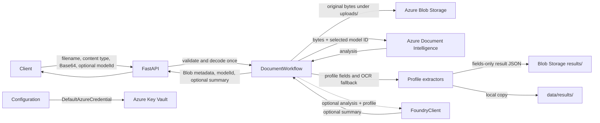

# Document Intelligence and Foundry

A Python document-processing backend that accepts Base64 JSON, stores a PDF or
image in Azure Blob Storage, and extracts OCR/layout information with Azure AI
Document Intelligence. Optional Microsoft Foundry summaries are disabled by
default.

> **Current scope:** the API uses a configured default model (`prebuilt-layout`)
> or an explicitly selected profile. Automatic classification, a background
> queue, and an MCP server are not implemented.

## Architecture

### Current runtime



`src/config.py` reads non-secret settings from environment variables / `.env`
and retrieves service endpoints and the Document Intelligence key from Key
Vault. Azure SDK clients authenticate with `DefaultAzureCredential`.

### Request sequence

```text
POST /documents/analyze
  -> validate filename, content type, and Base64 content (10 MB decoded limit)
  -> upload original bytes under uploads/ in the configured Blob container
  -> call Document Intelligence using the configured or requested model ID
  -> extract allowlisted model fields, or parse profile fields from OCR lines
  -> save only the fields object under results/ and data/results/
  -> optionally call the Foundry agent when FOUNDRY_ENABLED=true
  -> return Blob metadata, model ID, and optional summary
```

The API handles requests synchronously. Clients send JSON with `filename`,
`contentType`, `contentBase64`, and optional `modelId` (in the JSON body or as
the `?modelId=` query parameter). `Base64Document` strips
data URL headers, validates and decodes Base64 once, and enforces the decoded
size limit. The Azure SDK receives the resulting raw bytes. The result JSON
contains a `fields` object only; it omits full OCR text and Azure layout
metadata. The API returns Blob URLs as metadata and does not create SAS URLs.
Original PDFs are stored
under `uploads/` with a unique name; compact results are stored under
`results/<unique-document-name>_ocr_result.json` and copied locally to
`data/results/`. These result files contain only profile-selected fields,
without the full OCR text or Azure analysis payload.

## Components

| Path | Responsibility |
|---|---|
| `Backend/api.py` | FastAPI app, health route, upload validation, workflow construction |
| `src/config.py` | Non-secret settings and Key Vault secret loading |
| `src/processing/base64_document.py` | Validates and converts Base64 document content |
| `src/processing/profiles.py` | Defines model IDs, field allowlists, hints, and prompts |
| `src/processing/field_parser.py` | Parses profile fields from OCR when model fields are absent |
| `src/processing/field_values.py` | Normalizes Azure field values for compact results |
| `src/services/document_workflow.py` | Coordinates upload, analysis, result storage, and optional Foundry |
| `src/services/blob_storage.py` | Uploads and downloads documents in Blob Storage |
| `src/services/document_intelligence.py` | Calls the configured Document Intelligence model |
| `src/services/foundry/client.py` | Invokes the configured Foundry agent |
| `src/services/foundry/response.py` | Parses Foundry JSON or text responses |
| `src/processing/text_select.py` | Selects and compacts OCR lines |
| `src/processing/extractors.py` | Extracts OCR text or allowlisted model fields |
| `src/processing/summarize.py` | Applies a profile and runs the Foundry client |
| `src/models/result_writer.py` | Shapes OCR output into Pydantic models and writes JSON |
| `scripts/document_ocr.py` | Runs OCR on a local file or URL from the command line |
| `scripts/foundry_ocr.py` | Sends an existing OCR JSON result to Foundry |
| `data/results/` | Local generated CLI OCR and Foundry JSON files (ignored by Git) |
| `docs/` | Architecture, schemas, Azure setup, and extension guides |

## Configuration and secrets

Copy the template and set your local values:

```powershell
Copy-Item .env.example .env
```

The `.env` file holds non-secret settings. The following values are read from
Key Vault by `src/config.py`:

| Key Vault secret | Purpose |
|---|---|
| `DocumentIntelligenceEndpoint` | Document Intelligence endpoint |
| `DocumentIntelligenceKey` | Document Intelligence API key |
| `FoundryEndpoint` | Optional Foundry project endpoint; read only when Foundry is enabled |
| `AzureBlobStorageUrl` | Blob Storage account URL |

The legacy secret name `AzureBlobStorageURl` is accepted as a fallback. You can
override the Document Intelligence key secret name with
`DOCUMENT_INTELLIGENCE_KEY_SECRET_NAME`.

Example non-secret settings (see `.env.example` for the full list):

```env
AZURE_KEY_VAULT_URL=https://<vault-name>.vault.azure.net/
AZURE_STORAGE_CONTAINER_NAME=<existing-container>
DOCUMENT_INTELLIGENCE_MODEL_ID=prebuilt-layout
FOUNDRY_ENABLED=false
# Required only when FOUNDRY_ENABLED=true
# FOUNDRY_AGENT_NAME=<agent-name>
# FOUNDRY_AGENT_VERSION=1
```

When Foundry is disabled, its endpoint and agent settings are not loaded and
the app starts without them. To enable summaries, set `FOUNDRY_ENABLED=true`
and configure the Foundry endpoint secret, agent name, and optional version.

Do not put keys, passwords, connection strings, or SAS tokens in `.env` or
source code. Keep `.env` local and out of Git.

### Azure identity and permissions

For local development, sign in with Azure CLI. In an Azure deployment, use a
managed identity where possible.

| Resource | Required access |
|---|---|
| Key Vault | `Key Vault Secrets User` |
| Blob Storage | `Storage Blob Data Contributor` (uploads and downloads) |
| Foundry project (optional) | A project role that allows the identity to use the agent |

Role assignments can take several minutes to propagate. Azure management-plane
`Contributor` by itself does not grant Blob data access.

## Run locally

Install dependencies into the project virtual environment:

```powershell
.\.venv\Scripts\python.exe -m pip install -r requirements.txt
```

Authenticate and start the API from the **project root** (the directory that
contains `.venv`, `Backend`, `src`, and `requirements.txt`):

```powershell
az login
.\.venv\Scripts\python.exe -m uvicorn Backend.api:app --reload
```

Check liveness at `http://127.0.0.1:8000/health` and open the interactive API
docs at `http://127.0.0.1:8000/docs`.

Upload a supported file:

```powershell
curl.exe -X POST "http://127.0.0.1:8000/documents/analyze" `
  -H "Content-Type: application/json" `
  -d '{"filename":"document.pdf","contentType":"application/pdf","contentBase64":"<base64-content>"}'
```

Supported media types are PDF, JPEG, PNG, TIFF, and BMP. The API limit is
10 MB. This endpoint requires Key Vault, Blob Storage, and Document
Intelligence settings and permissions. Foundry is optional and disabled by
default.

### Start and test with a Base64 image

Open PowerShell in the project root. In the first terminal, activate the
project environment and start the API:

```powershell
Set-ExecutionPolicy -Scope Process -ExecutionPolicy RemoteSigned
& .\.venv\Scripts\Activate.ps1
python -m uvicorn Backend.api:app --reload
```

Keep that terminal running. Open a second PowerShell terminal in the project
root, activate the environment, and submit the Base64 image created in
`byte64-convert\result\`:

```powershell
Set-ExecutionPolicy -Scope Process -ExecutionPolicy RemoteSigned
& .\.venv\Scripts\Activate.ps1
$b64 = (Get-Content -Raw -LiteralPath ".\byte64-convert\result\pancard.png.base64.txt").Trim()
$body = @{ filename = "pancard.png"; contentType = "image/png"; contentBase64 = $b64 } | ConvertTo-Json -Compress
Invoke-RestMethod -Method Post -Uri "http://127.0.0.1:8000/documents/analyze?modelId=prebuilt-idDocument" -ContentType "application/json" -Body $body
```

The response includes the uploaded Blob names and URLs, plus the selected
`modelId`.

## Command-line workflows

Run OCR on a local file:

```powershell
.\.venv\Scripts\python.exe -m scripts.document_ocr "C:\path\to\document.pdf"
```

Choose a model explicitly:

```powershell
.\.venv\Scripts\python.exe -m scripts.document_ocr `
  "C:\path\to\document.pdf" --model-id prebuilt-read
```

The standalone OCR CLI and API workflow write compact result files to
`data/results/`. API workflow results are also stored
under `results/` in Blob Storage and returned as `ocrBlobName` and
`ocrBlobUrl`. To send an existing result to Foundry, first enable Foundry:

```powershell
.\.venv\Scripts\python.exe -m scripts.foundry_ocr `
  ".\data\results\document_ocr_result.json"
```

The processing profile selects an extractor, defines optional OCR hints or
field allowlists, caps the text sent to the agent, and defines the prompt.
Foundry parses a JSON response when possible; non-JSON text is preserved.

## Adding a model

Add one frozen `Profile` entry to
`src/processing/profiles.py`, including the Document Intelligence model ID,
prompt, `kind="ocr"` for page-line text or `kind="fields"` for structured
fields, plus any hints or field allowlist and character limit. The workflow,
API, and CLI then use it without new model-specific logic.

## API response

The `POST /documents/analyze` endpoint returns this response when Foundry is
disabled:

```json
{
  "blobName": "uploads/<unique>_document.pdf",
  "blobUrl": "https://<account>.blob.core.windows.net/<container>/uploads/<unique>_document.pdf",
  "ocrBlobName": "results/<unique>_document_ocr_result.json",
  "ocrBlobUrl": "https://<account>.blob.core.windows.net/<container>/results/<unique>_document_ocr_result.json",
  "modelId": "prebuilt-layout"
}
```

When Foundry is enabled, a `summary` property is added. It is omitted entirely
when Foundry is disabled. The stored JSON contains the allowlisted `fields`
object only; it omits the full OCR text and Azure layout metadata.

The response contains a Blob URL, not a download token. Protect the response
and the OCR Blob because documents and extracted text may contain sensitive
data.

## Current limitations and scale-up plan

The following are useful next steps; they are **not current features**:

1. **Classify, then route.** Add a Document Intelligence custom classifier to
   detect types such as ID, invoice, receipt, or other. Route each class to its
   appropriate analyzer and provide an unknown/low-confidence path for review.
2. **Add ID extraction.** Route ID documents to the prebuilt ID document model
   (`prebuilt-idDocument`) while preserving the current layout OCR path for
   other documents. Confirm the model's supported ID types for your region and
   scenario before relying on extracted fields.
3. **Move long work off the request.** For higher volume, accept and store the
   upload, enqueue a job, and return a job ID. Background workers can run OCR
   and Foundry processing; add a status/result endpoint for clients.
4. **Use durable result storage.** Store OCR/agent results in Blob Storage or a
   database instead of relying on the local `data/results/` folder when
   deploying multiple instances or containers.
5. **Make processing safer to retry.** Use unique document/job identifiers,
   avoid overwriting blobs that share a filename, track processing states, and
   make retries idempotent.
6. **Add operational controls.** Add structured logs with correlation IDs,
   metrics, timeouts, retry policies, concurrency limits, and clear error
   states. Do not log document contents or secrets.
7. **Add MCP only when needed.** To let a Foundry agent call this capability as
   a tool, expose a remote HTTPS MCP endpoint for classification/OCR and
   register that endpoint with the agent. Keep the MCP tool focused on document
   processing; avoid having the same agent call itself through that tool.

References: [Document Intelligence model overview](https://learn.microsoft.com/azure/ai-services/document-intelligence/model-overview?view=doc-intel-4.0.0),
[custom classifier guide](https://learn.microsoft.com/azure/ai-services/document-intelligence/train/custom-classifier?view=doc-intel-4.0.0),
[Foundry MCP connection guide](https://learn.microsoft.com/azure/ai-foundry/agents/how-to/tools/model-context-protocol?view=foundry-classic).

## Troubleshooting

### Python cannot find `src`

Run Uvicorn from the project root using `Backend.api:app`, as shown above. Do
not start it with the current directory set to `Backend` unless you also set
the Python import path appropriately.

### Key Vault authentication or missing secret

Run `az account show`, confirm `AZURE_KEY_VAULT_URL`, check the exact secret
names above, and verify the signed-in identity has `Key Vault Secrets User`.
Never print secret values while troubleshooting.

### Blob `AuthorizationPermissionMismatch`

Confirm the running identity has `Storage Blob Data Contributor` on the
storage account or container. A management-plane `Contributor` role is not
enough for Blob data operations.

### Foundry authorization failure

Confirm the `FoundryEndpoint` secret points to the intended project and the
running identity is authorized to use that project and agent.

## Related project guides

- [Azure CLI setup](docs/azure-cli-setup.md)
- [Architecture notes](docs/architecture.md)
- [Model extension guide](docs/model-extension-guide.md)
- [Extension guide](docs/extension-guide.md)
- [Custom model schema](docs/custom-model-schema.md)
- [Result schema](docs/result-schema.md)
