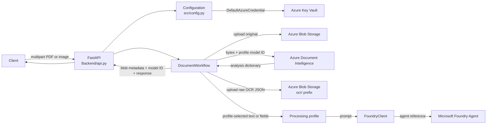

# Document Intelligence and Foundry Architecture

## Purpose

The service accepts a PDF or image, stores the upload in Azure Blob Storage,
analyzes its bytes with Azure AI Document Intelligence, stores the raw analysis
JSON, and sends profile-selected OCR text or fields to a Microsoft Foundry
agent for post-processing.

The API currently processes requests synchronously. A model profile can be
selected from the profiles configured in `src/processing/profiles.py`; the
default is `prebuilt-layout`. There is no automatic document classification,
background queue, or MCP endpoint.

## Runtime architecture

Azure SDK clients use `DefaultAzureCredential`. The configuration module reads
non-secret settings from environment variables or `.env` and loads configured
service endpoints and credentials from Key Vault.

## Request sequence

`POST /documents/analyze` performs these steps:

1. Validate the filename, supported media type, and 10 MB upload limit.
2. Resolve the requested model profile, or use the configured default.
3. Upload the original file to the configured Blob container.
4. Submit the document bytes to Document Intelligence using the profile's
   model ID.
5. Serialize the complete analysis result and save it under
   `ocr/<document>_ocr_result.json` in Blob Storage.
6. Select and compact OCR text or allowlisted fields according to the profile.
7. Send the profile prompt and selected data to the configured Foundry agent.
8. Return original and OCR Blob metadata, the model ID, and the agent response.

The response includes Blob URLs but does not create SAS URLs. The client waits
for the storage, OCR, and Foundry calls to finish.

## Components

| Path | Responsibility |
|---|---|
| `Backend/api.py` | FastAPI health and analysis routes, upload validation, workflow construction |
| `src/config.py` | Environment settings and Key Vault secret loading |
| `src/services/document_workflow.py` | Coordinates upload, OCR storage, profile selection, and Foundry processing |
| `src/services/blob_storage.py` | Uploads and downloads documents in Blob Storage |
| `src/services/document_intelligence.py` | Calls the configured Document Intelligence model |
| `src/services/foundry/client.py` | Invokes the configured Foundry agent |
| `src/services/foundry/response.py` | Parses JSON responses and preserves plain text responses |
| `src/processing/profiles.py` | Maps model IDs to prompts, extractor kinds, hints, and field allowlists |
| `src/processing/text_select.py` | Selects and compacts OCR lines |
| `src/processing/extractors.py` | Extracts OCR text or allowlisted model fields |
| `src/processing/summarize.py` | Applies the profile and runs the Foundry client |
| `src/models/result_writer.py` | Shapes and writes CLI OCR result JSON |
| `scripts/document_ocr.py` | Runs OCR on a local file or URL from the command line |
| `scripts/foundry_ocr.py` | Sends an existing OCR JSON result to Foundry |
| `data/results/` | Local generated CLI OCR and Foundry JSON files (ignored by Git) |

## Configuration and identity

Keep non-secret values in `.env` and credentials in Key Vault. The current
configuration includes the Key Vault URL, storage container, default model ID,
and Foundry agent name/version. Key Vault supplies the Document Intelligence
endpoint and key, Foundry project endpoint, and Blob Storage account URL.

Azure SDK clients authenticate through `DefaultAzureCredential`. Local
development can use Azure CLI sign-in; deployed services should use a managed
identity where possible. The identity needs Key Vault secret access, Blob data
access, and permission to use the configured Foundry agent. Azure management
plane `Contributor` alone does not grant Blob data access.

## Design principles

- Keep Azure SDK calls within their service wrappers.
- Keep request validation and HTTP error mapping in the API layer.
- Keep orchestration in `DocumentWorkflow` so the API and CLI can reuse
  processing components.
- Keep model-specific prompts, hints, extraction kinds, and field allowlists
  in profiles rather than branching throughout the workflow.
- Store the raw analysis separately from the compact data sent to Foundry.
- Do not log document contents or secrets.

## Current limitations and extension points

- The API handles each upload synchronously; high-volume deployments may need
  a job queue, workers, and a status/result endpoint.
- Model choice is explicit or configured by default. Classification and
  confidence-based routing are future work.
- Blob uploads currently use the filename-derived blob name and overwrite an
  existing blob with the same name. A production workflow should use unique
  document/job identifiers and idempotent retries.
- Local CLI results are written to `data/results/`; multi-instance deployments
  should use durable shared storage.
- Add a model by adding a profile in `src/processing/profiles.py`; see the
  [model extension guide](model-extension-guide.md).
- An MCP endpoint is not part of the current runtime. Add one only if a
  Foundry agent needs to call this service as a tool.

See the [README](../README.md) for setup and usage instructions and the
[Azure CLI setup guide](azure-cli-setup.md) for local authentication.
