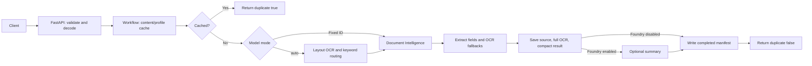

# Document Intelligence and Foundry Architecture

## Purpose

The API accepts one Base64 PDF or image per request, extracts document fields
with Azure AI Document Intelligence, and stores the source and results in Azure
Blob Storage. A Foundry summary can be added when enabled.

Requests run synchronously. The API supports the configured model, an explicit
model ID, or `modelId=auto` for keyword-based routing from OCR text.

## Request flow

## Processing steps

1. `Backend/api.py` validates the filename and supported `contentType`, then
   decodes Base64 with a 10 MB decoded-size limit.
2. `src/services/document_workflow.py` hashes the file bytes and model/profile
   settings, then checks for a completed manifest.
3. On a cache miss, a fixed model is called directly. With `modelId=auto`, the
   workflow calls `prebuilt-layout`, routes from its OCR text, then calls the
   selected model when it is not the layout fallback.
4. `src/processing/extractors.py` creates allowlisted fields. The profile field
   parser can fill missing values from OCR labels; ID address parsing supports
   labeled, multi-line address text.
5. Unreadable documents return HTTP `422` before Blob Storage writes. Readable
   documents save the source, complete Document Intelligence response, and
   compact result. The compact result contains `fullOcrBlobName` and
   `fullOcrBlobUrl` links.
6. The workflow optionally calls Foundry, writes the cache manifest last, and
   returns the model ID, Blob URLs, and `duplicate` status.

## Blob layout and duplicate handling

| Prefix | Contents |
|---|---|
| `uploads/` | Original bytes named by SHA-256 content hash |
| `results/` | Compact field result keyed by content and profile settings |
| `full-ocr/` | Full Document Intelligence analysis JSON |
| `manifests/` | Completed response used to serve cache hits |

The filename does not determine a cache hit. Same bytes with the same
processing settings reuse the response (`duplicate: true`); changed bytes under
the same filename get a new result (`duplicate: false`). Different explicit
models use different result keys. Manifests are written only after processing
completes. Concurrent identical requests are not locked and can both run.

Blob URLs are returned without SAS tokens. The full analysis and compact
result can contain sensitive identity data; protect the container and response.

## Security

- Store Azure credentials in Key Vault. Use Azure CLI login locally and a
  managed identity when deployed.
- Keep the Blob container private. Returned links do not include access tokens.
- Protect uploaded files and OCR results because they may contain personal
  information. Do not commit or log document contents.
- Upload trusted files with the correct content type. The API limits files to
  10 MB but does not check the file’s actual format.

## How automatic model selection works

- Set `modelId` to `"auto"` in the request.
- The system reads the document’s text using the **prebuilt-layout** model.
- It checks the OCR text for keywords and phrases. **The filename does not decide the model.**
- It scores matches for each model:
  - Invoice terms → `prebuilt-invoice`
  - Receipt terms → `prebuilt-receipt`
  - ID terms such as Aadhaar, PAN, passport, or driver’s license → `prebuilt-idDocument`
  - 10-Q terms → `prebuilt-layout`
- If one model gets a clear score, the system selects it and extracts fields with that model.
- If there are too few clues or the top scores are tied, it uses `prebuilt-layout` as the fallback.
- For a recognized invoice, receipt, or ID, auto mode may make **two OCR calls**: one to read and classify the text, then another with the selected model.
- If you provide a specific `modelId` instead of `"auto"`, the system skips classification and uses that model directly.

## Errors and edge cases

| Condition | HTTP status |
|---|---:|
| Missing filename, invalid Base64, empty file, unsupported model ID | `400` |
| Unsupported `contentType` | `415` |
| File larger than 10 MB | `413` |
| No readable OCR text or extracted fields | `422` |
| Azure, Blob Storage, or Foundry failure | `502` |

The API checks that the declared `contentType` is supported but does not verify
the file signature. Clients should send the correct MIME type. A wrong but
supported model ID can return null or low-confidence fields rather than an
error.

## Components in request order

| Stage | Main code |
|---|---|
| API and Base64 | `Backend/api.py`, `src/processing/base64_document.py` |
| Workflow and caching | `src/services/document_workflow.py`, `src/services/blob_storage.py` |
| Auto routing and profiles | `src/processing/document_classifier.py`, `src/processing/profiles.py` |
| Azure analysis and result shaping | `src/services/document_intelligence.py`, `src/processing/extractors.py`, `src/processing/field_parser.py` |
| Optional summary | `src/processing/summarize.py`, `src/services/foundry/` |
| Standalone local CLI | `scripts/document_ocr.py`, `scripts/foundry_ocr.py` |

The standalone OCR CLI writes local results and does not use API auto routing,
the API cache, or Blob Storage. See the [README](../README.md) for commands and
the [Azure setup guide](azure-cli-setup.md) for credentials and permissions.
